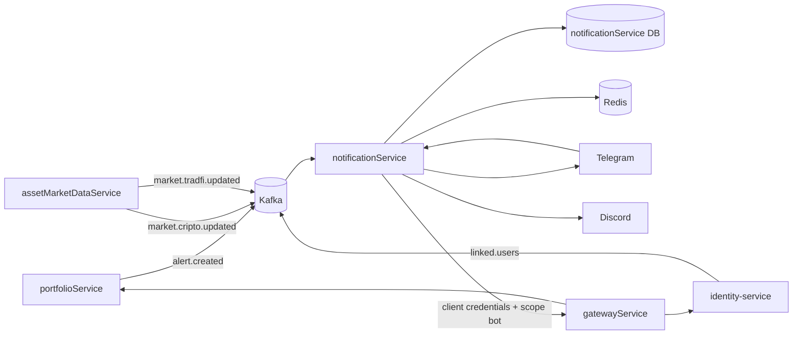
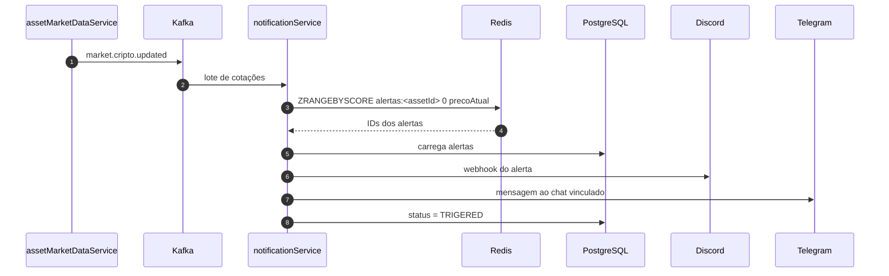

# notificationService

**Alertas de preço e bots do ChainTracker.** O serviço consome eventos de mercado pelo Kafka, verifica os alertas cadastrados, envia notificações por Telegram e Discord e opera o bot do Telegram que permite consultar portfólios, criar posições e cadastrar alertas sem sair do chat.

---

## Visão geral

O `notificationService` é um serviço **orientado a eventos** com dois papéis:

1. **Motor de alertas**: recebe alertas criados pelo `portfolioService`, indexa no Redis e compara o preço-alvo com cada atualização de mercado publicada pelo `assetMarketDataService`.
2. **Bot worker**: mantém um bot do Telegram com fluxo conversacional completo e um bot do Discord para comandos básicos e webhook de alertas.

O serviço **não expõe endpoints HTTP de negócio**. A porta `8086` existe para o Actuator e para a saúde do container. Toda a interação do usuário acontece pelo Telegram, e todas as operações de portfólio são feitas por chamadas HTTP ao `gatewayService`.

---

## Stack

| Item | Tecnologia |
|---|---|
| Linguagem / runtime | Java 21 |
| Framework | Spring Boot 4.1.1 |
| Build | Maven (wrapper `mvnw`) |
| HTTP | Spring Web MVC + `RestClient` |
| Persistência | Spring Data JPA + PostgreSQL |
| Migrações | Flyway (`spring-boot-starter-flyway` + módulo PostgreSQL) |
| Cache / índice | Redis (`spring-boot-starter-data-redis`) |
| Mensageria | Kafka (`spring-boot-starter-kafka`) |
| Telegram | `java-telegram-bot-api` 10.3.0 |
| Discord | JDA 5.6.1 + webhook |
| Segurança | Spring Security OAuth2 Resource Server + OAuth2 Client |
| Observabilidade | Actuator + Micrometer Prometheus |
| Produtividade | Lombok |

---

## Posição no ecossistema



### Tópicos consumidos

| Tópico | Grupo | Conteúdo | Efeito |
|---|---|---|---|
| `alert.created` | `notification.service` | `AlertRequestDto(userId, assetId, price)` | grava o alerta e o adiciona ao índice Redis |
| `market.cripto.updated` | `notification.service` | cotação de cripto | verifica os alertas do ativo |
| `market.tradfi.updated` | `notification.service` | cotação de ação | verifica os alertas do ativo |
| `linked.users` | `notificationService` | `LinkedUserResponseDto(userId, chatId)` | atualiza a tabela local de vínculos |

### Chamadas de saída

| Destino | Uso |
|---|---|
| `http://gateway:3006/api` | rotas do bot no `identity-service` e no `portfolioService` |
| `http://assetmarketdata-service:8082/api` | catálogo e cotações de cripto e TradFi usados pelo bot |
| API do Telegram | receber updates e enviar mensagens |
| Webhook do Discord | publicar alertas |
| Gateway do Discord (JDA) | bot do Discord |

As chamadas ao gateway usam o client OAuth2 `notification-service` (`notification-client`) com **client credentials** e escopo **`bot`**, o que dá acesso às rotas `/api/bot/**`.

---

## Como funciona

### 1. Ingestão de alertas

O listener de `alert.created`:

1. desserializa o payload em `AlertRequestDto`;
2. converte para a entidade `Alert`, com status inicial `WAITING`;
3. grava o alerta no PostgreSQL;
4. adiciona o ID do alerta ao sorted set Redis `alertas:<assetId>`, usando o **preço-alvo como score**.

O sorted set funciona como índice: para saber quais alertas podem ter sido atingidos, o serviço consulta apenas os membros com score menor ou igual ao preço atual.

```text
chave: alertas:bitcoin
membro: <uuid do alerta>   score: 65000
membro: <uuid do alerta>   score: 70000
```

### 2. Verificação a cada atualização de mercado

O listener de `market.cripto.updated` e `market.tradfi.updated` recebe os eventos **em lote** (`batch = "true"`). Para cada evento:

1. extrai `assetId` e `price` do `KafkaAlert`;
   - o preço aceita os nomes `price`, `currentPrice` ou `current_price`;
   - o ativo usa `id` quando presente (cripto) e, na ausência dele, `symbol` (ações);
2. consulta `ZRANGEBYSCORE alertas:<assetId> 0 <precoAtual>`;
3. carrega os alertas correspondentes no PostgreSQL;
4. para cada alerta com status `WAITING` e `precoAtual >= precoAlvo`:
   - envia a mensagem ao **Discord** pelo webhook;
   - localiza o chat do Telegram vinculado ao `userId` e envia a mensagem em HTML;
   - marca o alerta como `TRIGERED` e registra `last_notification`;
   - grava o alerta atualizado.

Se o envio ao Discord falhar, a falha é registrada em log e o fluxo continua, para que o Telegram ainda receba o alerta. O alerta permanece no sorted set; o status `WAITING` é o que impede um novo disparo nas verificações seguintes.



### 3. Mensagens de alerta

| Canal | Formato |
|---|---|
| Discord | Markdown, com título, ativo, preço-alvo, preço atual e horário relativo |
| Telegram | HTML, com ativo, preço-alvo, preço atual, percentual acima do alvo e data/hora |

No Telegram, o nome do ativo digitado pelo usuário é escapado antes de entrar na mensagem HTML.

### 4. Vínculo de contas

O `identity-service` publica `linked.users` sempre que um vínculo é criado. O `notificationService` consome o evento e grava `linked_user(user_id, chat_id)`. Essa tabela local é usada pelo bot para:

- descobrir o `userId` a partir do `chatId`;
- verificar se o chat já está vinculado;
- descobrir o `chatId` de um usuário na hora de enviar um alerta.

O chat também pode ser vinculado diretamente pelo comando `/vincular`, que chama `POST /api/bot/auth/link` no `identity-service` através do gateway.

### 5. Bot do Telegram

O bot é registrado no `@PostConstruct` com `SetMyCommands` e processa os updates em um `UpdatesListener`. O estado de cada conversa fica em um `ConcurrentHashMap<Long, Conversa>`, indexado pelo `chatId`.

#### Comandos

| Comando | Função |
|---|---|
| `/start` | mensagem inicial com as opções de conta |
| `/help` | lista os comandos disponíveis |
| `/vincular <codigo>` | vincula o chat a uma conta existente usando o código gerado no site |
| `/criarconta` | inicia o cadastro de uma conta pelo próprio Telegram |
| `/portfolio` ou `/portfolios` | lista os portfólios do usuário |
| `/newportfolio` | cria um portfólio |
| `/alerta` | cria um alerta de preço |
| `/buscar` | pesquisa ativos de cripto e TradFi e mostra todos os dados disponíveis |
| `/cancelar` | cancela a operação em andamento |
| `/teste` | responde com data/hora e chat ID para verificar se o bot está ativo |

Comandos desconhecidos recebem “Comando não reconhecido.”.

#### Vínculo

1. O usuário envia `/vincular <codigo>`.
2. O bot verifica na tabela local se o chat já está vinculado.
3. Se não estiver, chama `POST /api/bot/auth/link` com `code` e `chatId`.
4. Em caso de sucesso, confirma; caso contrário, informa que o código é inválido ou expirou.

#### Criação de conta

1. `/criarconta` inicia a conversa, desde que o chat ainda não esteja vinculado.
2. O bot pede o **username** (3 a 30 caracteres; letras, números, ponto, hífen ou sublinhado).
3. Pede o **e-mail** (formato válido, até 254 caracteres).
4. Pede a **senha** (8 a 128 caracteres) e avisa que ela ficará no histórico da conversa.
5. Chama `POST /api/bot/auth/register` com username, e-mail, senha e `chatId`.
6. Trata o resultado:
   - `SUCCESS`: conta criada e vinculada;
   - `CONFLICT`: username, e-mail ou chat já em uso; reinicia pelo username;
   - `INVALID`: dados recusados; reinicia pelo username;
   - `ERROR`: falha temporária; encerra a conversa.

#### Consulta de portfólio

`/portfolio` busca o usuário pelo chat e lista os portfólios em botões inline. Ao abrir um portfólio, o bot mostra:

- patrimônio total;
- resultado da carteira em valor e percentual;
- melhor e pior desempenho;
- cada posição com símbolo, nome, quantidade, preço médio, preço atual da moeda, valor atual da posição e PnL.

O preço atual é consultado no `assetMarketDataService` para cada posição (cripto ou TradFi). Se a cotação não estiver disponível, o campo aparece como `—`.

O teclado do portfólio oferece:

| Botão | Ação |
|---|---|
| ➕ Adicionar | inicia a compra de um ativo |
| ➖ Diminuir | vende parte de uma posição |
| 🗑️ Remover | vende a posição inteira, após confirmação |
| 🔄 Atualizar | recarrega posições e resumo |
| 🔔 Criar alerta | cria um alerta já associado ao portfólio |
| 🔎 Buscar ativo | pesquisa cripto ou TradFi e mostra todos os dados do ativo |
| 🗑️ Excluir portfólio | exclui o portfólio após confirmação |

#### Buscar ativo

1. `/buscar` (ou o botão **🔎 Buscar ativo** dentro do portfólio) pede o nome, o símbolo ou o id do ativo.
2. O bot chama `GET /api/bot/assets/search?q=<termo>` no `assetMarketDataService` e lista até 10 criptos e 10 ações.
3. Ao escolher um resultado, o bot consulta a cotação individual:
   - cripto: `GET /api/bot/currency/{id}`;
   - TradFi: `GET /api/bot/stock/{symbol}`.
4. A resposta reúne tipo, id, símbolo, nome, bolsa e status do catálogo, além de preço atual, market cap, ranking e variação de 24h para cripto, ou abertura, máxima e mínima para ação.
5. Símbolos são sempre exibidos em maiúsculas, tanto na busca quanto nas posições e alertas.

#### Adicionar posição

1. Escolha do tipo: `CRIPTO` ou `STOCK`.
2. Informe o ativo: id, ticker ou nome da cripto; símbolo da ação.
3. Informe a quantidade.
4. Escolha entre **preço de mercado** e **preço informado**.
5. O bot chama `POST /api/bot/portfolio/{id}/positions/{tipo}/market` ou `POST /api/bot/portfolio/{id}/positions/{tipo}` e volta para a tela do portfólio.

#### Diminuir posição

1. O bot lista as posições em botões.
2. O usuário escolhe a posição e informa a quantidade, que não pode superar a quantidade em carteira.
3. Escolhe entre preço de mercado e preço informado.
4. O bot chama `POST /api/bot/portfolio/{id}/positions/sell`.

#### Remover posição

1. O bot lista as posições e pede confirmação.
2. Confirmada a remoção, a quantidade vendida é a posição inteira.
3. O fluxo segue para a escolha de preço e chama a mesma rota de venda.

#### Criar alerta

1. Escolha do tipo: cripto ou ação.
2. Informe o ativo.
3. Informe o preço-alvo maior que zero.
4. O bot chama `POST /api/bot/alert?userId` no `portfolioService`, que normaliza o ativo e publica `alert.created`.
5. O alerta entra no motor de alertas deste serviço pelo Kafka.

### 6. Bot do Discord

O `DiscordConfig` cria uma instância JDA com o token configurado e registra o comando `/ping`. O webhook do Discord, separado do bot, é usado pelo motor de alertas para publicar as mensagens no canal configurado.

---

## Modelo de dados

As migrações Flyway ficam em `src/main/resources/db/migration`. O JPA roda com `ddl-auto: validate`: o schema é responsabilidade das migrações.

### Tabela `alert`

| Coluna | Tipo | Observação |
|---|---|---|
| `id` | `uuid` | chave primária |
| `user_id` | `uuid` | dono do alerta |
| `asset_id` | `varchar` | id da cripto ou símbolo da ação |
| `price` | `numeric(36,18)` | preço-alvo |
| `status` | `varchar` | `WAITING`, `TRIGERED` ou `COOLDOWN` |
| `last_notification` | `timestamp` | último disparo |

O status inicial é `WAITING`. O valor `TRIGERED` é a grafia usada no código para o alerta já disparado. O valor `COOLDOWN` existe no enum, mas o fluxo atual não o utiliza.

### Tabela `linked_user`

| Coluna | Tipo | Observação |
|---|---|---|
| `id` | `uuid` | chave primária |
| `user_id` | `uuid` | usuário no Keycloak |
| `chat_id` | `bigint` | chat do Telegram |

As consultas usam `findByChatId` e `findByUserId`.

### Índice Redis

| Item | Valor |
|---|---|
| Chave | `alertas:<assetId>` |
| Tipo | sorted set |
| Membro | UUID do alerta |
| Score | preço-alvo |

O Redis é usado apenas como índice de busca dos alertas; o estado oficial fica no PostgreSQL.

---

## API HTTP

O serviço **não possui controllers de negócio**. A porta interna é **8086** e, no stack completo, é exposta como **3005**.

O que existe é o Actuator, com os endpoints padrão de saúde e métricas:

| Método | Caminho | Descrição |
|---|---|---|
| `GET` | `/actuator/health` | estado da aplicação |
| `GET` | `/actuator/metrics` | métricas |

O Actuator segue a regra geral de segurança do serviço e exige autenticação. Toda a interação funcional acontece pelo Telegram e pelo Discord.

### Documentação OpenAPI

O serviço **não gera uma especificação OpenAPI**, porque não possui controllers HTTP de negócio para documentar. As operações expostas ao usuário são comandos do bot do Telegram e do Discord, e as chamadas HTTP que o serviço faz são para o `gatewayService`.

As APIs dos demais serviços podem ser consultadas no Swagger UI agregado em `http://localhost:3006/swagger-ui.html`.

---

## Configuração

Arquivo principal: `src/main/resources/application.yaml`.

| Propriedade | Valor padrão | Observação |
|---|---|---|
| `server.port` | `8086` | porta interna |
| `spring.datasource.url` | `jdbc:postgresql://notification-service-db:5432/notificationService` | banco do serviço |
| `spring.jpa.hibernate.ddl-auto` | `validate` | schema validado contra as migrações |
| `spring.flyway.enabled` | `true` | migrações habilitadas |
| `spring.flyway.repair-on-migrate` | `true` | repara o histórico antes de migrar |
| `spring.flyway.baseline-on-migrate` | `false` | banco novo começa do zero |
| `spring.data.redis.host` | `my-redis` | Redis |
| `spring.data.redis.port` | `6379` | porta do Redis |
| `spring.kafka.bootstrap-servers` | `kafka:9092` | broker |
| `spring.kafka.listener.type` | `batch` | consumo em lote |
| `spring.security.oauth2.resourceserver.jwt.issuer-uri` | `http://keycloak:8080/realms/ChainTracker` | validação de JWT |
| `spring.security.oauth2.client.registration.notification-service.client-id` | `notification-client` | client OAuth2 |
| `...registration.notification-service.authorization-grant-type` | `client_credentials` | chamadas de serviço |
| `...registration.notification-service.scope` | `bot` | acesso às rotas `/api/bot/**` |
| `...registration.notification-service.provider` | `keycloak` | provider OAuth2 |
| `notification.telegram.bot-name` | `ChainTrackerPortfolioBot` | nome do bot |
| `notification.telegram.key` | — | variável `TELEGRAM_KEY` |
| `notification.discord.token` | — | variável `DISCORD_TOKEN` |
| `notification.discord.webhook-url` | — | variável `DISCORD_WEBHOOK_URL` |

### Variáveis de ambiente

```bash
TELEGRAM_KEY=...
DISCORD_TOKEN=...
DISCORD_WEBHOOK_URL=...
NOTIFICATION_CLIENT_SECRET=...
```

O provider OAuth2 usa o token endpoint `http://keycloak:8080/realms/ChainTracker/protocol/openid-connect/token`.

---

## Como executar

### Localmente

Pré-requisitos: Java 21, PostgreSQL, Redis, Kafka e um Keycloak com o realm `ChainTracker`.

```bash
export TELEGRAM_KEY=...
export DISCORD_TOKEN=...
export DISCORD_WEBHOOK_URL=...
export NOTIFICATION_CLIENT_SECRET=...

./mvnw spring-boot:run
```

### Com Docker

```bash
./mvnw clean package -DskipTests

docker build -t notification-service .
docker run --rm -p 3005:8086 \
  -e TELEGRAM_KEY=... \
  -e DISCORD_TOKEN=... \
  -e DISCORD_WEBHOOK_URL=... \
  -e NOTIFICATION_CLIENT_SECRET=... \
  notification-service
```

### No stack completo

No repositório `ChainTracker`, o serviço é construído a partir do diretório configurado no compose, exposto em `3005:8086` e conectado aos bancos, Kafka, Redis e Keycloak da rede `chaintracker-network`.

---

## Estrutura do projeto

```text
notificationService1/
├── src/main/java/com/example/notificationservice/
│   ├── client/          # IdentityClient, PortfolioClient, AlertClient, AssetMarketDataClient
│   ├── config/          # Telegram, Discord, OAuth2 e Security
│   ├── domain/          # entidades Alert e LinkedUser
│   ├── dto/             # contratos internos, do bot e de ativos
│   ├── enums/           # AlertStatus, PositionType, RegistrationStatus
│   ├── listener/        # TelegramUpdateListener
│   ├── mapper/          # conversão de alertas
│   ├── repository/      # repositórios Spring Data
│   └── service/         # AlertService, AssetService, IdentityService, PortfolioService, PositionService, TelegramService
├── src/main/resources/
│   ├── application.yaml
│   └── db/migration/    # migrações Flyway
├── Dockerfile
├── pom.xml
└── mvnw / mvnw.cmd
```

---

## Observabilidade

- `spring-boot-starter-actuator` expõe health e métricas na porta `8086`.
- `micrometer-registry-prometheus` publica métricas no formato Prometheus.
- O `AlertService` registra em log a criação de alertas (`ALERTA CRIADO`), o disparo (`TRIGGERED`) e falhas de envio ao Discord ou ao Telegram.
- O bot registra no console falhas de callback, de criação de portfólio, de posição e de alerta, sem interromper o recebimento de novos updates.
